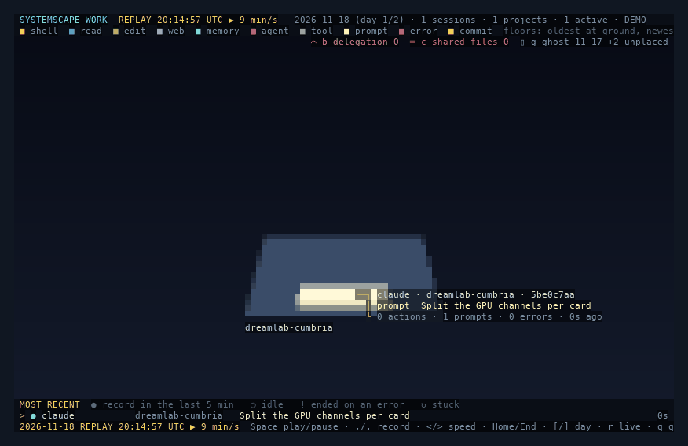
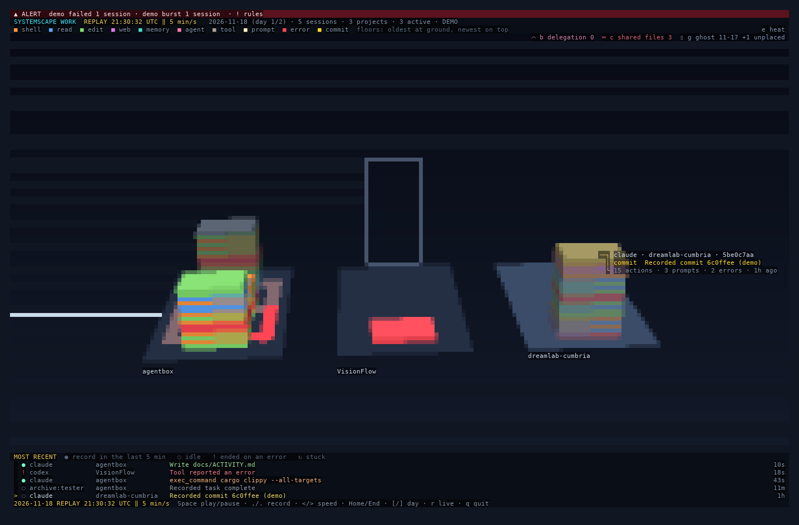
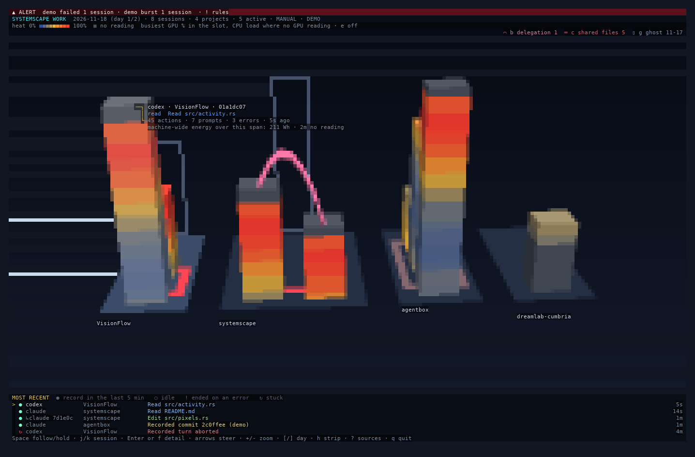
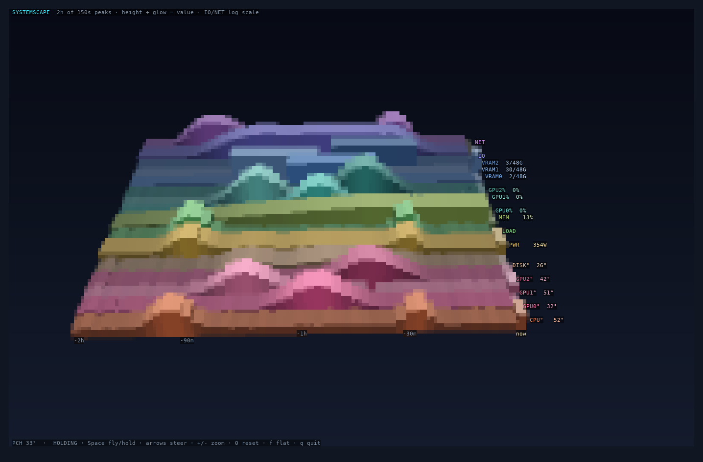
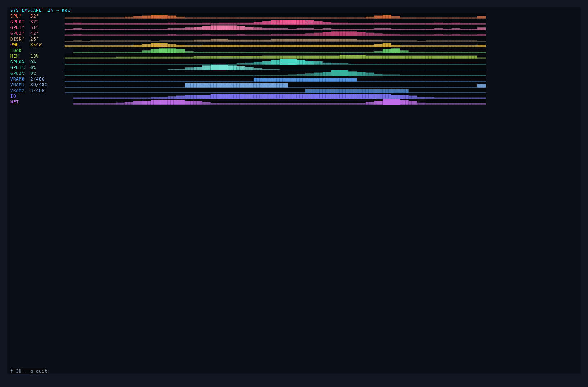
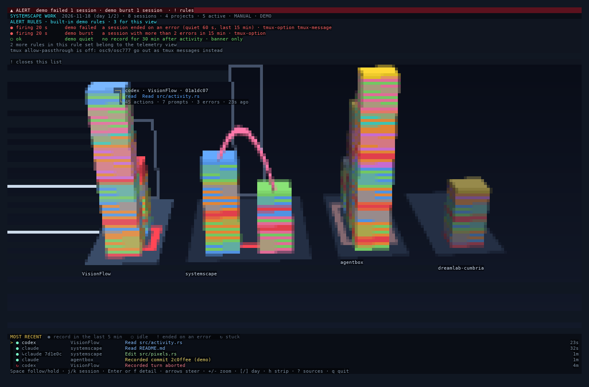

# SystemScape

**Interactive 3D system telemetry and agent work history for your terminal.**

Telemetry can cover several machines at once: list them in a hosts file and
SystemScape reads each one's sensors over SSH (see [Other machines](#other-machines)).

SystemScape has two views: hardware telemetry shows what changed together;
agent activity shows who worked on what, with selectable records and their sources.
Both use [gemini-engine](https://github.com/renpenguin/gemini-engine) and run locally.
The repository was previously named `thermal3d`; the binary remains `systemscape`.

## Screenshots

These are captures of the running application in 200×65 tmux panes. Activity
uses synthetic records; telemetry uses a synthetic history with live NOW readings.
The red line at the top of some captures is the alert banner raised by the
demo's built-in rules.

**Agent work in 3D** — a city of recorded work. Each district is a project,
each tower a session, each floor a recorded action coloured by what it was.
The pink arc joins a session to the subagent it started, the red roads join
sessions that edited the same file, and the grey outlines are the previous
day's skyline. The selected tower carries a callout; the strip below lists the
most recent sessions, with `↻` on one that keeps repeating a failing command.


**Replay** — press `r` and the day is rebuilt record by record; `--activity
--cast` writes the same replay as an asciinema recording.





**Heat** — press `e` to tint each floor by how busy the machine was when the
record was made, from a history kept with `systemscape --record`.



**Activity detail** — press Enter or `f`, or shrink the pane below 80 columns
or 20 rows: every session of the day, then every record of the selected one.


**System telemetry** — one labelled ridge per channel, GPUs split per card,
correlates temperatures, power, load, memory, GPU work, disk and network traffic.
Marks along the front edge are recorded commits, errors and agent calls; the
VRAM labels name the processes holding the memory, and `▲` flags a value above
its usual band.



**Telemetry sparklines** — press `f`, or use a pane under 80 columns or 20 rows.



**Alerts** — rules from a TOML file raise the banner; `!` lists them.



To reproduce these captures, see [screenshots](docs/SCREENSHOTS.md).

## Agent activity

```sh
systemscape --activity          # local work history, interactive 3D
systemscape --activity --demo   # synthetic fixture; opens no agent histories
systemscape --activity --text   # readable day/project/agent/session records
systemscape --activity --json   # records plus coverage, for other local tools
systemscape --activity --summary   # one day's digest, see Reports and other tools
systemscape --activity --cast --demo > day.cast   # a replay as an asciinema recording
```

Activity reads Claude Code and Codex session histories, including Claude
subagents and Agentbox profiles. It also reads Agentbox's shared event archive,
so any agent that emits there can appear, regardless of its harness. Agents
without a readable transcript or archived event are not visible.

The 3D view is for a glance and the detail view is for reading.

**The city.** Records are grouped by UTC day. Each project is a district,
named along its front edge, and each session is a tower. Floors stack oldest
at the ground to newest on top, coloured by what the record was:

| Colour | Record |
|--------|--------|
| orange | shell command |
| blue | read or search |
| green | edit or write |
| violet | web or browser |
| teal | memory |
| pink | delegated agent or skill |
| grey | other tool |
| cream | prompt |
| red | error |
| gold | recorded commit |

A session with a record in the last five minutes is drawn at full colour with
a pulsing roof; idle sessions are dimmed. Districts run left to right in order
of recent activity, and within a district the most recent session stands at
the front. The tallest tower sets the scale for all of them, so heights compare
within a day; a session with thousands of records merges neighbouring floors
rather than growing without limit, and an error or commit inside a merged
floor always keeps its colour. The city shows the 36 most recent sessions in up
to eight districts; the rest are in the detail view.

The selected tower carries a tethered callout with the agent, project,
session, its latest record and its counts. The strip along the bottom lists the
five most recent sessions with a status dot (`●` record in the last five
minutes, `○` idle, `!` ended on an error), what each last did and how long ago.
By default the tour follows live work: the camera sways in front of the city
and every six seconds moves the selection to the next active session, or to
the next session of any kind when none is active.

**Subagents, shared files and yesterday.** A Claude subagent is its own tower,
standing beside the session that started it and joined to it by a pink arc
(`b`); its name reads `parent/child`, and `↳` marks it in the strip. When two
sessions edited the same file on the day shown, a road joins their towers
(`c`), red while both are active; at most six are drawn and the key counts the
rest. A faint outline of the previous recorded day's skyline stands behind
today's (`g`). See [city links](docs/features/city.md).

**Replay.** `r` replays the day on screen: the city is drawn as it stood at a
cut-off time and towers grow floor by floor. The header and bottom row say
`REPLAY`, the cut-off time and the speed, so a replay is not mistaken for live
work. `--activity --cast` writes the same replay to standard output as an
asciicast v2 recording. A recording contains record text, which may include
sensitive prompts and commands: use `--demo` for anything you share. See
[replay](docs/features/replay.md).

**Heat.** With a recorded telemetry history (`systemscape --record`, see
[Recorded history](#recorded-history)), `e` tints each floor by how busy the
machine was when that record was made: the busiest GPU's utilisation, or CPU
load where there is no GPU reading. Times with no reading stay grey. The
callout and detail view give the machine's energy over the session's span.
That figure covers everything running then; power cannot be divided between
sessions that ran at the same time. See [join](docs/features/join.md).

**Stuck sessions.** A session whose most recent tool calls repeat one command,
each followed by a failure, three times running is marked `↻` in the strip and
the detail view. It is a reading of logged records, not proof of a loop.

**The detail view.** Enter or `f` opens it for the selected session; panes
under 80 columns or 20 rows always use it. The top lists every session of the
day with its status, age, counts and latest record. Below are the selected
session's records, newest first, each with its time, kind and text. The bottom
lines give the selected record in full and its project and session, or its
source file after Enter.

Tool records keep what the tool was given: the file path, the first line of
the command, the search pattern or the query. Codex wraps most calls in an
`exec` script; the record names the tool called inside it.

"Active" means a record arrived recently. It is evidence of logged activity,
not proof that an agent is running or that a task succeeded.

| Key | City | Detail view |
|-----|------|-------------|
| Space | Follow live work / hold | same |
| `j` / `k` | Next / previous session | Next / previous record |
| Tab / Shift-Tab | Next / previous session | same |
| Enter | Open the detail view | Toggle source path |
| `f` | Open the detail view | Back to the city |
| Page Up / Page Down | | Ten records at a time |
| `[` / `]` | Older / newer day | same |
| Left / Right, Up / Down | Turn, raise or lower the camera | |
| `+` / `-`, `0` | Zoom, reset the camera | |
| `h` | Show / hide the most-recent strip | |
| `b` / `c` / `g` | Show / hide delegation arcs, shared-file roads, the ghost skyline | `b` / `c`: the subagent and shared-file lines |
| `e` | Heat: tint floors by recorded machine load | Machine-wide energy line |
| `r` | Replay the day shown / back to live | same |
| Space, `,` / `.`, `<` / `>`, Home / End (replaying) | Play or pause, step one record, slower or faster, first or last record | same |
| `!` | Open or close the alert rule list | same |
| `?` | Show / hide source coverage | same |
| `q`, Escape, Ctrl-C | Quit and restore the terminal (Escape first leaves a replay) | same |

Any key other than Space, `h` and `?` holds the tour; Space resumes it.

No model calls, network requests, database or writes to source histories are
needed. Three things step outside that, and each happens only when its flag is
given: `--llama-metrics` makes an HTTP request, `--metrics` listens on a
socket, and `--record` writes one file. Each transcript is read as an append-only log from a saved offset, so
a poll costs only the bytes written since the last one. The collector polls
every two seconds and discovers files every 30 seconds. It reads at most 1 MiB
per file and 8 MiB per poll, tracks at most 256 files and keeps the newest
5,000 records, dropping the oldest first.

**Background tabs do no work.** In tmux, a view is on screen when its window
is the current window of an attached session. Off screen, the activity view
neither polls nor draws, and catches up from the saved offsets when shown
again; telemetry stops drawing but keeps sampling, querying `nvidia-smi` every
ten seconds instead of two, so its two-hour history has no gaps. A view that is
on screen but not focused, for example beside the active pane in a split,
stays current but holds its camera and redraws twice a second. Visibility is
checked with tmux every two seconds, and focus reports (`set -g focus-events
on`) make changes immediate. Outside tmux a view is always treated as on
screen. While the tour is held, the view
redraws twice a second. Both views compare front/back row buffers and publish
only changed rows in synchronized terminal updates. Panes up to 512 columns ×
180 rows are supported.

Coverage (`?`) reports pending files, omitted files, malformed input and
truncated history. One-shot text/JSON output performs one bounded poll, so check
that coverage before treating it as a complete export; `--summary` keeps
polling for up to three seconds until no tracked file has unread bytes. Archives and transcripts
can describe the same work; their counts are not additive measures of completed
tasks or token spend. Commit receipts report what the transcript recorded and
are not checked against current git reachability. Excerpts are limited to 240
characters; use the source file for the full record.

## System telemetry

SystemScape renders host telemetry as a field of 3D ridges, one per channel,
each with its own hue and its name and live value at the NOW end. Ridges are
stacked into the depth axis, so a peak in one channel lines up with its cause
in another. Time always runs left to right: the camera sways, bobs and
breathes, but never orbits, and the floor carries half-hour ticks from `-2h`
to `now`.

The scene is drawn with half-block pixels: it is rasterised by
[gemini-engine](https://github.com/renpenguin/gemini-engine) at twice the
terminal's row count, then each pair of pixel rows becomes one row of `▀`
cells with separate foreground and background colours. That gives square
pixels, lit tops, shaded sides and distance haze. Text labels sit on their own
layer and stay crisp.

## Telemetry channels

Front to back:

| Ridge | Source | Scale |
|-------|--------|-------|
| CPU° | `coretemp` hwmon, hottest package or core across sockets; AMD `k10temp` hottest core die, else `Tdie`, else `Tctl` | 25–95 °C |
| GPU*n*° | `nvidia-smi`, one ridge per card | 25–90 °C |
| DISK° | `nvme` hwmon composite | 25–75 °C |
| PWR | ACPI `power_meter`, whole-system watts | 0–900 W |
| LOAD | `/proc/stat` busy % | 0–100 % |
| MEM | `/proc/meminfo` used % | 0–100 % |
| GPU*n*% | `nvidia-smi` utilisation, one ridge per card | 0–100 % |
| VRAM*n* | `nvidia-smi` memory used, one ridge per card | 0–card total |
| IO | `/proc/diskstats`, physical-disk reads + writes | log, 0–5000 MB/s |
| NET | `/proc/net/dev`, RX + TX excluding loopback | log, 0–1250 MB/s |
| container CPU and memory | `docker stats`, the busiest containers; only with `--containers`, and only while on screen | 0–100 % |
| LLM tok, busy, waiting | a llama.cpp server's `/metrics` over plain HTTP; only with `--llama-metrics URL` | own scale |

Cards of one kind are shades of that kind's hue and sit closer together than
different kinds. The status line additionally reports PCH and NIC (`ixgbe`)
temperatures. Missing sources degrade gracefully: a ridge with no data does
not appear, and a host without `nvidia-smi` shows no GPU ridges.

Each VRAM label names the processes using the most memory on that card. A
process in another PID namespace, as seen from inside a container, shows as
its PID or not at all. A label pulses and shows `▲` when the channel's value
rises above its own band over the two-hour window. At most six named ridges
(containers, model server) are drawn. See [sensors](docs/features/sensors.md).

**Activity marks.** The time axis carries marks for recorded commits (`◆`),
errors (`✕`) and delegated-agent calls (`↳`) from this machine's agent
histories, so a spike can be matched to what was recorded then. Labels are
built from kinds, counts and a project name, never from prompt or command
text. `m` hides them; `--no-marks` stops the telemetry view reading agent
histories at all. With a hosts file, marks appear only on this machine.

## Alerts

Rules in a TOML file raise a banner line, and if asked a terminal bell, a
desktop notification or a tmux message, when a channel stays past a threshold,
a host link is lost, a session ends on an error, errors come in a burst or
work goes quiet. `!` lists the rules and their states in either view.

```sh
cp docs/alerts.example.toml ~/.config/systemscape/alerts.toml   # then edit it
systemscape --alerts ./rules.toml      # a different file
```

Notification text is built from rule names and numbers, never from record
text. Telemetry rules keep evaluating while the view is off screen, as its
sampling does; activity rules rest with the view. See
[alerts](docs/features/alerts.md).

## Recorded history

`systemscape --record` (or `--probe --record`) appends each closed 150-second
slot to `$XDG_STATE_HOME/systemscape/telemetry.jsonl`, else
`~/.local/state/systemscape/telemetry.jsonl`: the time, power, CPU load, GPU
temperature and utilisation, and memory. It holds 14 days, is readable only by
its owner and contains no record text. This is the only file SystemScape
writes, and only with the flag. The activity view reads it for heat.

## Reports and other tools

```sh
systemscape --status                    # 3 active · 1 stuck · 71°C 412W
systemscape --activity --summary        # one day: projects, sessions, stuck sessions, contended files
systemscape --mcp                       # read-only MCP server on stdio, for agents
systemscape --metrics 127.0.0.1:9108    # OpenMetrics endpoint, until interrupted
```

A day's summary looks like this (`--activity --summary --demo`, shortened):

```text
Activity on 2026-11-18 (UTC): 4 projects · 8 sessions · 275 records · 63 edits · 20 errors · 3 commits
STUCK      codex 77e385bc-demo in workspace/VisionFlow: "Bash cargo test --locked" failed 3 times running, last at 18:02
CONTENDED  /workspace/agentbox/src/telemetry.rs edited by 3 sessions: archive:tester handoff-17, claude 9c2d4410-demo, claude a3f09e11-demo
■ /workspace/VisionFlow  17:34–18:07  2 sessions · 63 tools · 17 edits · 8 errors · 0 commits
  codex          01a1dc07-demo          17:34–18:07    7p   45t  11e   3✗  0c
  codex          77e385bc-demo          17:47–18:02    3p   18t   6e   5✗  0c  STUCK
```

`--status` prints one short line and returns in about a tenth of a second,
from a single bounded poll, so its counts can be low just after start-up. For
a tmux status bar:

```sh
set -g status-right '#(systemscape --status --tmux) %H:%M'
```

`--mcp` answers questions such as who is editing a file, which files are
contended and which sessions are stuck. Its results are data from transcripts
and should be treated by the caller as untrusted text. `--metrics` binds to
loopback only unless `--metrics-allow-remote` is given. See [insight](docs/features/insight.md).

## Other machines

A hosts file adds other machines to the telemetry view. Each one runs
`systemscape --probe`, which prints one JSON line of that machine's readings
every interval, and SystemScape reads those lines over the system OpenSSH
client. Every machine keeps its own two-hour history from the moment the view
starts, so switching between them never shows a gap.

```sh
cp docs/hosts.example.toml ~/.config/systemscape/hosts.toml   # then edit it
systemscape                         # this machine plus the listed hosts
systemscape --hosts ./lab.toml      # a different file
```

The default file is `$XDG_CONFIG_HOME/systemscape/hosts.toml`, else
`~/.config/systemscape/hosts.toml`. Without it SystemScape shows only the
machine it runs on, exactly as before; a file named with `--hosts` must exist.
[`docs/hosts.example.toml`](docs/hosts.example.toml) documents every field.

```toml
[[host]]
name = "render-box"
ssh = "user@render-box.example"
probe = "/home/user/.local/bin/systemscape"
```

Install the same SystemScape version on each machine and point `probe` at it.
The probe needs no terminal, configuration or privileges, and reads the same
sources as the local view. It exits as soon as nobody reads its output, so
quitting the viewer or losing the connection leaves nothing running.

**Credentials stay with OpenSSH.** The hosts file holds no secret. SystemScape
runs `ssh` with arguments, never through a local shell, with `BatchMode` (it
never prompts), a five-second connect timeout and keep-alives that drop a dead
link within about fifteen seconds. Keys, agents, jump hosts and host-key
checking come from your `~/.ssh/config`; a host that needs a password or an
unknown host key is shown as failed, with SSH's reason. The probe path and
destination are checked before use, because the remote login shell runs the
command.

**The host strip.** The top line lists every machine: `●` live, `◌`
connecting, `○` connected but silent for three intervals (its live values are
cleared and new slots stay empty), `!` not running, with the reason on the
status line, for example `probe not found (exit 127)` or `ssh failed:
Permission denied (publickey).`. A failed host is retried with backoff up to
a minute. Tab and Shift-Tab, or `1`–`9`, choose the machine on screen.

A probe of a different protocol version is reported as incompatible and not
read. Fields one version does not know are ignored, and fields it lacks show
as no reading, so viewers and probes of nearby versions still agree.

**Probe cost.** The GPU query is the expensive part, so a probe asks
`nvidia-smi` every `gpu_interval` seconds (default 10) and repeats the last
card readings in between; other sensors are read every `interval` (default 2).
On a workstation driving a VR headset at 90 Hz, a probe at the defaults left
the frame rate within normal variation: 60 seconds with the probe ran at
82–91 fps (23% of seconds at 87 or below), 120 seconds without it at 81–91 fps
(38%). If a host does stutter, raise its `gpu_interval`.

A host can name a local `command` instead of `ssh`, for any wrapper that
prints probe lines, such as `docker exec -i NAME systemscape --probe`.

## Feature guides

Each newer feature has its own page with flags, keys, limits and what it does
not claim:

| Guide | Covers |
|-------|--------|
| [City links](docs/features/city.md) | delegation arcs, shared-file roads, the ghost skyline |
| [Replay](docs/features/replay.md) | the `r` scrubber and `--activity --cast` |
| [Join](docs/features/join.md) | activity marks on the time axis, `--record`, heat and machine-wide energy |
| [Sensors](docs/features/sensors.md) | VRAM processes, `--containers`, `--llama-metrics`, the anomaly flag |
| [Alerts](docs/features/alerts.md) | rule file format, notifications, tmux output |
| [Insight](docs/features/insight.md) | `--status`, `--summary`, stuck sessions, `--mcp`, `--metrics` |

## Design

- **2-hour window**: 48 slots × 150 s, newest at the right edge, plus the
  live slot, which is brighter.
- **Peak-hold downsampling**: sensors are polled every 2 s on a background
  thread and each slot commits the *maximum* seen in its 150 s, so short
  spikes survive decimation.
- **Hue = channel, height and glow = value**: a ridge never changes hue, so it
  can be followed across the scene; taller slots are brighter and their tops
  whiter.
- **Log throughput**: IO and NET use a logarithmic scale so everyday traffic
  rises off the floor beside a multi-GB/s burst. Every other channel is linear.
- **Narrow panes**: below 80 columns or 20 rows (or with `f`) the view becomes
  one coloured sparkline per channel with its live value.
- **Render rate**: telemetry targets 18 FPS and writes only rows that changed.

## Build & run

```sh
cargo build --release
./target/release/systemscape          # live telemetry
./target/release/systemscape --demo   # prefill 2 h of synthetic, correlated data
./target/release/systemscape --hosts hosts.toml   # this machine plus other hosts
./target/release/systemscape --probe  # JSON lines for a viewer on another machine
./target/release/systemscape --activity
./target/release/systemscape --record --containers   # keep a history file, add container ridges
```

Requires Linux (`/sys/class/hwmon`, `/proc`) and a truecolour terminal.
`nvidia-smi` on PATH enables the per-card GPU ridges.

`--demo` fills every ridge with a deterministic synthetic story: two load
bursts that drag CPU temperature, power and network with them, a separate job
on each GPU at a different time that pulls that card's temperature, VRAM and
disk IO along, and a memory ramp. It always shows at least three GPUs, and is
useful for checking the full visual without waiting two hours.

| Key | Telemetry action |
|-----|------------------|
| Space | Hold / resume the camera flight |
| Left / Right | Turn (limited, so time stays left to right) |
| Up / Down | Raise / lower the camera |
| `+` / `-` | Zoom |
| `0` | Reset the camera |
| `f` | Switch between sparklines and 3D |
| Tab / Shift-Tab, `1`–`9` | Next / previous machine, or machine *n* (with a hosts file) |
| `m` | Show / hide activity marks on the time axis |
| `!` | Open or close the alert rule list |
| `q`, Escape, Ctrl-C | Quit and restore the terminal |

## tmux integration

```sh
tmux new-window -n System 'while true; do /path/to/systemscape; sleep 2; done'
tmux split-window -h -p 38 'btm --basic'
tmux new-window -n Activity 'systemscape --activity'
```

The 3D pane answers “what moved together over time?” while the companion pane
attributes the current event to processes, cores, disks, and interfaces.

## Containers

SystemScape is designed to work as an immutable image package. Run it inside
the container so `/proc` reflects the container-visible system view. GPU
telemetry requires `nvidia-smi` plus the NVIDIA runtime/device mapping;
hardware temperatures depend on which `/sys/class/hwmon` entries the runtime
exposes. Missing sources degrade gracefully. Disk and network rates derive
from container-visible `/proc/diskstats` and `/proc/net/dev` counters.

[DreamLab Agentbox](https://github.com/DreamLab-AI/agentbox) bakes SystemScape
into its Nix-built runtime. The System pane starts zoomed to the ridges; tmux prefix then `z` reveals
`btm` alongside for live attribution; the Activity window runs `systemscape --activity`.
Agentbox mounts an operator's hosts file read-only and links it to the default
path, so the System pane shows other machines without extra flags.

Inside a container, the viewer needs an `ssh` client and a key the remote host
accepts; the probe on the remote host runs outside any container and sees that
machine's sensors directly.

## Tuning

Telemetry settings are constants at the top of `src/telemetry.rs`:

| Constant | Meaning | Default |
|----------|---------|---------|
| `SLOT_SECS` | seconds per history slot (window = 48 × this) | 150 (2 h) |
| `HISTORY` | slots per ridge | 48 |
| `RELIEF` | world height of a full-scale value | 5.0 |
| `FOV` | lens angle in degrees; lower keeps rows evenly spaced | 48 |
| `POLL` | interval between local sensor polls (remote hosts: `interval` in the hosts file) | 2 s |
| `FRAME_MS` | frame budget | 55 (~18 FPS) |

Channel scales and hues are in `Channel::norm` and `Channel::hue`; the flight
path is in `render`.

## License

Apache-2.0. See [LICENSE](LICENSE). The agent-work view takes inspiration from
[bough](https://github.com/nickelsec/bough), an MIT-licensed local work-history
visualiser. This is an independent Rust implementation; no bough code is bundled.
