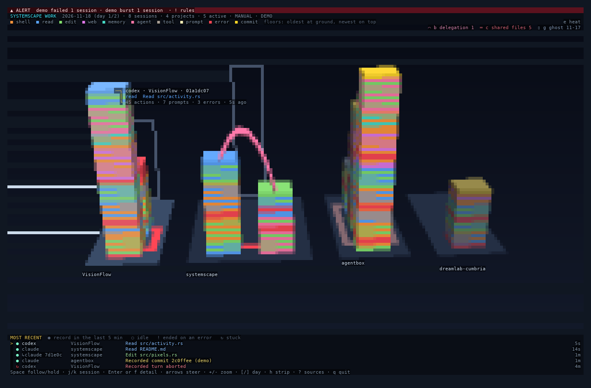
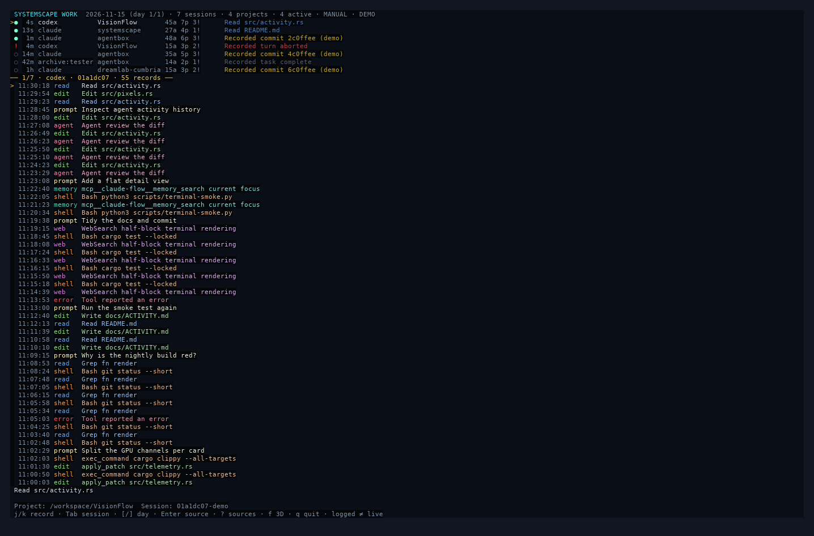

# SystemScape

**Interactive 3D system telemetry and agent work history for your terminal.**

SystemScape has two views: hardware telemetry shows what changed together;
agent activity shows who worked on what, with selectable records and their sources.
Both use [gemini-engine](https://github.com/renpenguin/gemini-engine) and run locally.
The repository was previously named `thermal3d`; the binary remains `systemscape`.

## Screenshots

These are captures of the running application in 200×65 tmux panes. Activity
uses synthetic records; telemetry uses a synthetic history with live NOW readings.

**Agent work in 3D** — a city of recorded work. Each district is a project,
each tower a session, each floor a recorded action coloured by what it was.
The selected tower carries a callout; the strip below lists the most recent
sessions and what each last did.



**System telemetry** — one labelled ridge per channel, GPUs split per card,
correlates temperatures, power, load, memory, GPU work, disk and network traffic.


**Telemetry sparklines** — press `f`, or use a pane under 80 columns or 20 rows.


**Activity detail** — press Enter or `f`, or shrink the pane below 80 columns
or 20 rows: every session of the day, then every record of the selected one.



To reproduce these captures, see [screenshots](docs/SCREENSHOTS.md).

## Agent activity

```sh
systemscape --activity          # local work history, interactive 3D
systemscape --activity --demo   # synthetic fixture; opens no agent histories
systemscape --activity --text   # readable day/project/agent/session records
systemscape --activity --json   # records plus coverage, for other local tools
```

Activity reads Claude Code and Codex session histories, including Claude
subagents and Agentbox profiles. It also reads Agentbox's shared event archive,
so any agent that emits there can appear, regardless of its harness. Agents
without a readable transcript or archived event are not visible.

The 3D view is for a glance and the detail view is for reading.

**The city.** Records are grouped by UTC day. Each project is a district,
named along its front edge, and each session is a tower. Floors stack oldest
at the ground to newest on top, coloured by what the record was:

| Colour | Record |
|--------|--------|
| orange | shell command |
| blue | read or search |
| green | edit or write |
| violet | web or browser |
| teal | memory |
| pink | delegated agent or skill |
| grey | other tool |
| cream | prompt |
| red | error |
| gold | recorded commit |

A session with a record in the last five minutes is drawn at full colour with
a pulsing roof; idle sessions are dimmed. Districts run left to right in order
of recent activity, and within a district the most recent session stands at
the front. The tallest tower sets the scale for all of them, so heights compare
within a day; a session with thousands of records merges neighbouring floors
rather than growing without limit, and an error or commit inside a merged
floor always keeps its colour. The city shows the 36 most recent sessions in up
to eight districts; the rest are in the detail view.

The selected tower carries a tethered callout with the agent, project,
session, its latest record and its counts. The strip along the bottom lists the
five most recent sessions with a status dot (`●` record in the last five
minutes, `○` idle, `!` ended on an error), what each last did and how long ago.
By default the tour follows live work: the camera sways in front of the city
and every six seconds moves the selection to the next active session, or to
the next session of any kind when none is active.

**The detail view.** Enter or `f` opens it for the selected session; panes
under 80 columns or 20 rows always use it. The top lists every session of the
day with its status, age, counts and latest record. Below are the selected
session's records, newest first, each with its time, kind and text. The bottom
lines give the selected record in full and its project and session, or its
source file after Enter.

Tool records keep what the tool was given: the file path, the first line of
the command, the search pattern or the query. Codex wraps most calls in an
`exec` script; the record names the tool called inside it.

"Active" means a record arrived recently. It is evidence of logged activity,
not proof that an agent is running or that a task succeeded.

| Key | City | Detail view |
|-----|------|-------------|
| Space | Follow live work / hold | same |
| `j` / `k` | Next / previous session | Next / previous record |
| Tab / Shift-Tab | Next / previous session | same |
| Enter | Open the detail view | Toggle source path |
| `f` | Open the detail view | Back to the city |
| Page Up / Page Down | | Ten records at a time |
| `[` / `]` | Older / newer day | same |
| Left / Right, Up / Down | Turn, raise or lower the camera | |
| `+` / `-`, `0` | Zoom, reset the camera | |
| `h` | Show / hide the most-recent strip | |
| `?` | Show / hide source coverage | same |
| `q`, Escape, Ctrl-C | Quit and restore the terminal | same |

Any key other than Space, `h` and `?` holds the tour; Space resumes it.

No model calls, network requests, database or writes to source histories are
needed. Each transcript is read as an append-only log from a saved offset, so
a poll costs only the bytes written since the last one. The collector polls
every two seconds and discovers files every 30 seconds. It reads at most 1 MiB
per file and 8 MiB per poll, tracks at most 256 files and keeps the newest
5,000 records, dropping the oldest first.

**Background tabs do no work.** Both views ask the terminal for focus reports.
While its tab is not on screen the activity view neither polls nor draws, and
catches up from the saved offsets when shown again. Telemetry stops drawing and
samples its sensors every ten seconds instead of two, so the two-hour history
stays unbroken. In tmux this needs `set -g focus-events on`; without focus
reports the views run as if always visible. While the tour is held, the view
redraws twice a second. Both views compare front/back row buffers and publish
only changed rows in synchronized terminal updates. Panes up to 512 columns ×
180 rows are supported.

Coverage (`?`) reports pending files, omitted files, malformed input and
truncated history. One-shot text/JSON output performs one bounded poll, so check
that coverage before treating it as a complete export. Archives and transcripts
can describe the same work; their counts are not additive measures of completed
tasks or token spend. Commit receipts report what the transcript recorded and
are not checked against current git reachability. Excerpts are limited to 240
characters; use the source file for the full record.

## System telemetry

SystemScape renders host telemetry as a field of 3D ridges, one per channel,
each with its own hue and its name and live value at the NOW end. Ridges are
stacked into the depth axis, so a peak in one channel lines up with its cause
in another. Time always runs left to right: the camera sways, bobs and
breathes, but never orbits, and the floor carries half-hour ticks from `-2h`
to `now`.

The scene is drawn with half-block pixels: it is rasterised by
[gemini-engine](https://github.com/renpenguin/gemini-engine) at twice the
terminal's row count, then each pair of pixel rows becomes one row of `▀`
cells with separate foreground and background colours. That gives square
pixels, lit tops, shaded sides and distance haze. Text labels sit on their own
layer and stay crisp.

## Telemetry channels

Front to back:

| Ridge | Source | Scale |
|-------|--------|-------|
| CPU° | `coretemp` hwmon, hottest package or core across sockets | 25–95 °C |
| GPU*n*° | `nvidia-smi`, one ridge per card | 25–90 °C |
| DISK° | `nvme` hwmon composite | 25–75 °C |
| PWR | ACPI `power_meter`, whole-system watts | 0–900 W |
| LOAD | `/proc/stat` busy % | 0–100 % |
| MEM | `/proc/meminfo` used % | 0–100 % |
| GPU*n*% | `nvidia-smi` utilisation, one ridge per card | 0–100 % |
| VRAM*n* | `nvidia-smi` memory used, one ridge per card | 0–card total |
| IO | `/proc/diskstats`, physical-disk reads + writes | log, 0–5000 MB/s |
| NET | `/proc/net/dev`, RX + TX excluding loopback | log, 0–1250 MB/s |

Cards of one kind are shades of that kind's hue and sit closer together than
different kinds. The status line additionally reports PCH and NIC (`ixgbe`)
temperatures. Missing sources degrade gracefully: a ridge with no data does
not appear, and a host without `nvidia-smi` shows no GPU ridges.

## Design

- **2-hour window**: 48 slots × 150 s, newest at the right edge, plus the
  live slot, which is brighter.
- **Peak-hold downsampling**: sensors are polled every 2 s on a background
  thread and each slot commits the *maximum* seen in its 150 s, so short
  spikes survive decimation.
- **Hue = channel, height and glow = value**: a ridge never changes hue, so it
  can be followed across the scene; taller slots are brighter and their tops
  whiter.
- **Log throughput**: IO and NET use a logarithmic scale so everyday traffic
  rises off the floor beside a multi-GB/s burst. Every other channel is linear.
- **Narrow panes**: below 80 columns or 20 rows (or with `f`) the view becomes
  one coloured sparkline per channel with its live value.
- **Render rate**: telemetry targets 18 FPS and writes only rows that changed.

## Build & run

```sh
cargo build --release
./target/release/systemscape          # live telemetry
./target/release/systemscape --demo   # prefill 2 h of synthetic, correlated data
./target/release/systemscape --activity
```

Requires Linux (`/sys/class/hwmon`, `/proc`) and a truecolour terminal.
`nvidia-smi` on PATH enables the per-card GPU ridges.

`--demo` fills every ridge with a deterministic synthetic story: two load
bursts that drag CPU temperature, power and network with them, a separate job
on each GPU at a different time that pulls that card's temperature, VRAM and
disk IO along, and a memory ramp. It always shows at least three GPUs, and is
useful for checking the full visual without waiting two hours.

| Key | Telemetry action |
|-----|------------------|
| Space | Hold / resume the camera flight |
| Left / Right | Turn (limited, so time stays left to right) |
| Up / Down | Raise / lower the camera |
| `+` / `-` | Zoom |
| `0` | Reset the camera |
| `f` | Switch between sparklines and 3D |
| `q`, Escape, Ctrl-C | Quit and restore the terminal |

## tmux integration

```sh
tmux new-window -n System 'while true; do /path/to/systemscape; sleep 2; done'
tmux split-window -h -p 38 'btm --basic'
tmux new-window -n Activity 'systemscape --activity'
```

The 3D pane answers “what moved together over time?” while the companion pane
attributes the current event to processes, cores, disks, and interfaces.

## Containers

SystemScape is designed to work as an immutable image package. Run it inside
the container so `/proc` reflects the container-visible system view. GPU
telemetry requires `nvidia-smi` plus the NVIDIA runtime/device mapping;
hardware temperatures depend on which `/sys/class/hwmon` entries the runtime
exposes. Missing sources degrade gracefully. Disk and network rates derive
from container-visible `/proc/diskstats` and `/proc/net/dev` counters.

[DreamLab Agentbox](https://github.com/DreamLab-AI/agentbox) bakes SystemScape
into its Nix-built runtime. The System pane starts zoomed to the ridges; tmux prefix then `z` reveals
`btm` alongside for live attribution; the Activity window runs `systemscape --activity`.

## Tuning

Telemetry settings are constants at the top of `src/telemetry.rs`:

| Constant | Meaning | Default |
|----------|---------|---------|
| `SLOT_SECS` | seconds per history slot (window = 48 × this) | 150 (2 h) |
| `HISTORY` | slots per ridge | 48 |
| `RELIEF` | world height of a full-scale value | 5.0 |
| `FOV` | lens angle in degrees; lower keeps rows evenly spaced | 48 |
| `POLL` | interval between sensor polls | 2 s |
| `FRAME_MS` | frame budget | 55 (~18 FPS) |

Channel scales and hues are in `Channel::norm` and `Channel::hue`; the flight
path is in `render`.

## License

Apache-2.0. See [LICENSE](LICENSE). The agent-work view takes inspiration from
[bough](https://github.com/nickelsec/bough), an MIT-licensed local work-history
visualiser. This is an independent Rust implementation; no bough code is bundled.
